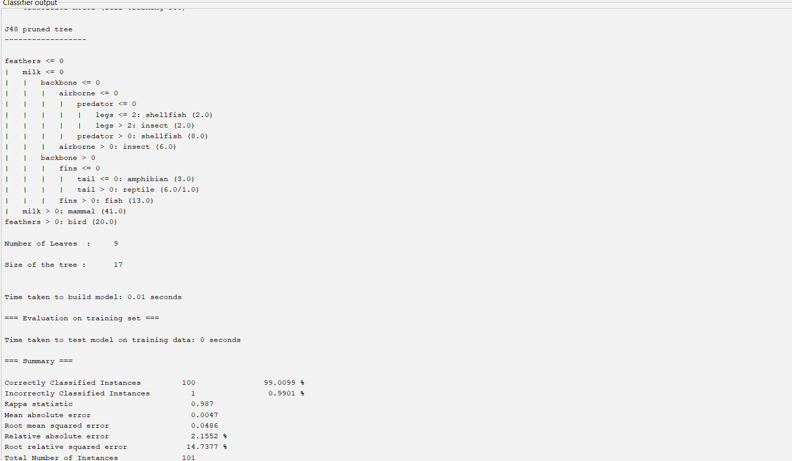
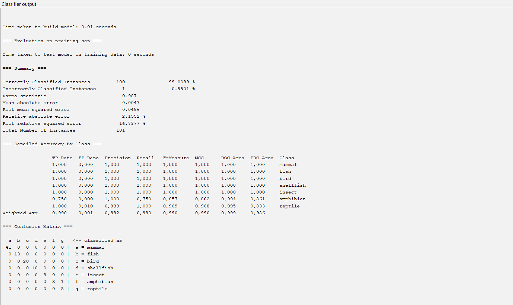
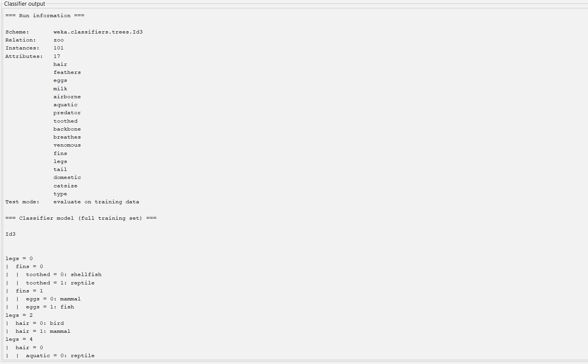
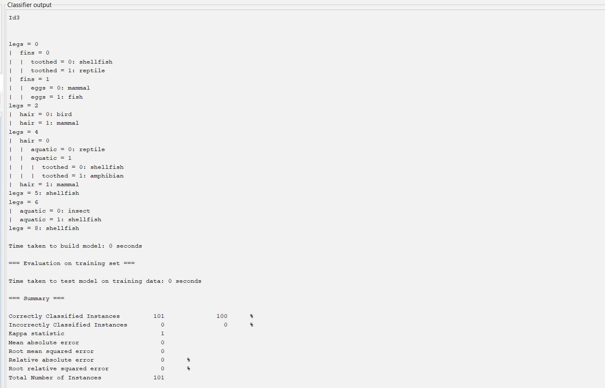
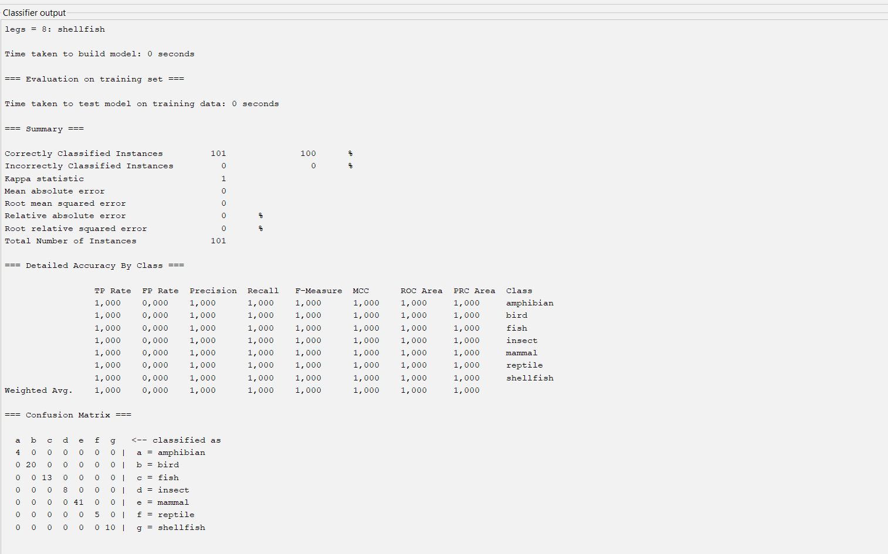
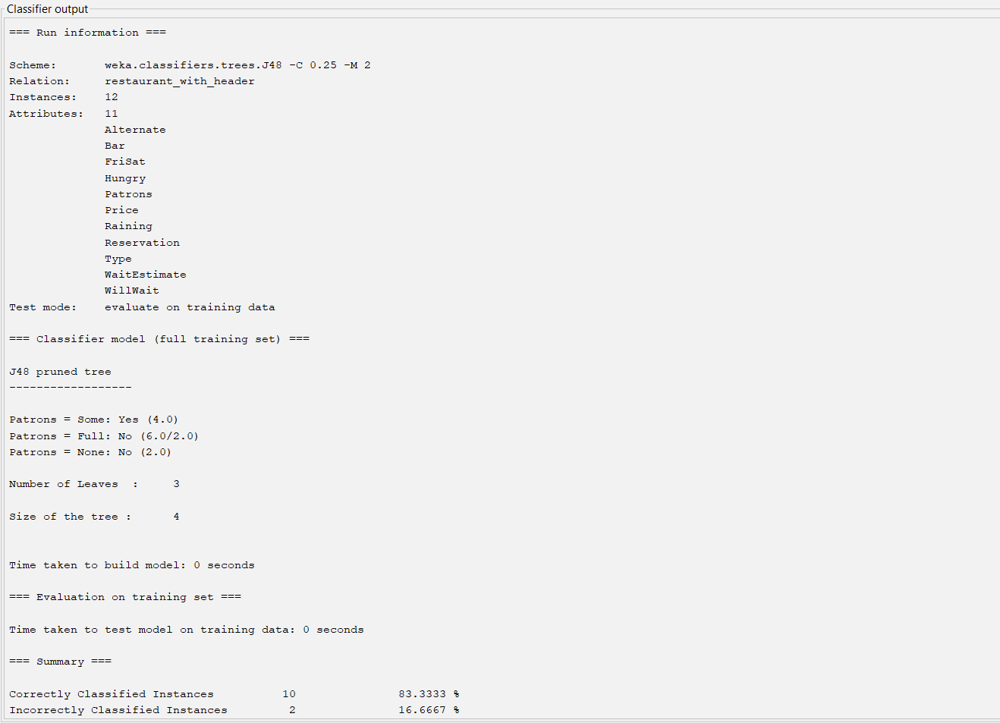
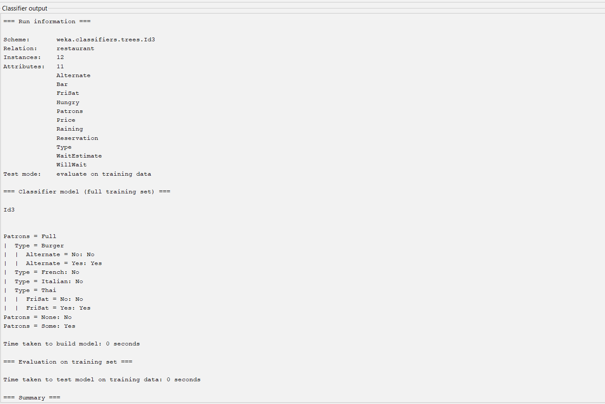
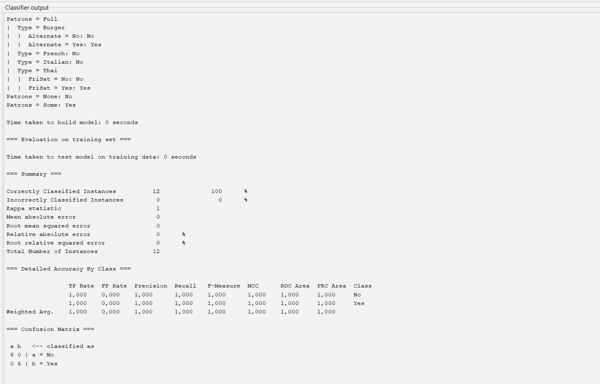

# DTL – Entscheidungsbäume


## Starke vs. Schwache KI (1P)

### Ist ChatGPT intelligent?

ChatGPT ist ein Beispiel für schwache künstliche Intelligenz. Das System kann Texte verstehen und erzeugen, Fragen beantworten, übersetzen und bei unterschiedlichen Aufgaben helfen. Der Kern des Systems ist ein großes Sprachmodell, das mithilfe neuronaler Netze und großer Datenmengen trainiert wurde. Es verarbeitet Zusammenhänge zwischen Wörtern und erzeugt passende Antworten. Dabei ist nicht nachgewiesen, dass ChatGPT ein eigenes Bewusstsein oder ein menschliches Verständnis besitzt.

### Gibt es intelligente Systeme?

Es gibt verschiedene KI-Systeme, die intelligente Leistungen erbringen. Beispiele sind Sprachassistenten, Bilderkennungssysteme, Übersetzungsprogramme und Systeme zur Unterstützung medizinischer Diagnosen. Sie erkennen Muster in Daten und treffen darauf basierend Vorhersagen oder Entscheidungen. Diese Systeme werden als schwache KI bezeichnet, weil sie bestimmte Aufgaben lösen, ohne über eine allgemeine menschliche Intelligenz zu verfügen.

### Brauchen wir starke KI?

Für viele praktische Anwendungen reicht schwache KI aus. Beispielsweise können Navigationssysteme optimale Routen berechnen und KI-Systeme bei der Erkennung von Krankheiten helfen. Dafür benötigen sie kein eigenes Bewusstsein. Eine starke KI könnte möglicherweise flexibler auf neue Situationen reagieren, ist aber für viele heutige Anwendungen nicht notwendig.

### Absicht, Auswirkungen und Risiken

Künstliche Intelligenz bietet viele Vorteile, beispielsweise in der Medizin, Bildung und Automatisierung. Gleichzeitig entstehen Risiken:

- **Robustheit:** KI-Systeme können bei unerwarteten Eingaben Fehler machen.
- **Falsche Korrelationen:** Ein System kann zufällige Zusammenhänge lernen und dadurch falsche Entscheidungen treffen.
- **Fairness und Bias:** Verzerrte Trainingsdaten können zu einer Benachteiligung bestimmter Personengruppen führen.
- **Sicherheit:** Fehlerhafte KI-Entscheidungen können in sicherheitskritischen Bereichen gefährlich sein.
- **Missbrauch:** KI kann für Spam, Betrug, Spear-Phishing und Desinformation eingesetzt werden.
- **Dual Use:** Technologien können sowohl für nützliche als auch für schädliche Zwecke verwendet werden, beispielsweise in der Forschung oder bei militärischen Anwendungen.

### Fazit

Schwache KI ist bereits heute für viele Aufgaben sehr nützlich. Entscheidend ist nicht nur, ob ein System intelligent wirkt, sondern auch, wie zuverlässig, sicher und verantwortungsvoll es eingesetzt wird.


## DTL.01 – Entscheidungsbäume mit ID3

### Entropie und Informationsgewinn

Die Trainingsmenge besteht aus 7 Wählern. Davon bevorzugen 4 den Kandidaten O und 3 den Kandidaten M.

Die Entropie beschreibt die Unreinheit einer Datenmenge und wird mit folgender Formel berechnet:

\[
H(S) = -p(O)\log_2(p(O)) - p(M)\log_2(p(M))
\]

Für die gesamte Trainingsmenge gilt:

\[
p(O)=\frac{4}{7}, \qquad p(M)=\frac{3}{7}
\]

Damit ergibt sich:

\[
H(S)=-\frac{4}{7}\log_2\left(\frac{4}{7}\right)
-\frac{3}{7}\log_2\left(\frac{3}{7}\right)
\]

\[
\boxed{H(S)\approx 0{,}9852}
\]

Der ID3-Algorithmus wählt das Attribut mit dem höchsten Informationsgewinn als Wurzel des Entscheidungsbaums.

Der Informationsgewinn wird berechnet durch:

\[
IG(S,A)=H(S)-\sum_{v\in Werte(A)}\frac{|S_v|}{|S|}H(S_v)
\]


Im nächsten Schritt werden die Attribute Alter, Einkommen und Bildung miteinander verglichen.


### Informationsgewinn für Alter

Für das Attribut Alter gibt es zwei Gruppen:

- Alter >= 35: 2 × O und 2 × M
- Alter < 35: 2 × O und 1 × M

Entropie der ersten Gruppe:

\[
H(S_{\geq35})=-\frac24\log_2\frac24-\frac24\log_2\frac24=1
\]

Entropie der zweiten Gruppe:

\[
H(S_{<35})=-\frac23\log_2\frac23-\frac13\log_2\frac13\approx0{,}9183
\]

Informationsgewinn:

\[
IG(S,\text{Alter})=0{,}9852-\left(\frac47\cdot1+\frac37\cdot0{,}9183\right)
\]

\[
IG(S,\text{Alter})\approx0{,}0202
\]


### Informationsgewinn für Einkommen

Für das Attribut Einkommen gibt es zwei Gruppen:

- Einkommen hoch: 3 × O und 1 × M
- Einkommen niedrig: 1 × O und 2 × M

Entropie für hohes Einkommen:

\[
H(S_{\text{hoch}})=-\frac34\log_2\frac34-\frac14\log_2\frac14\approx0{,}8113
\]

Entropie für niedriges Einkommen:

\[
H(S_{\text{niedrig}})=-\frac13\log_2\frac13-\frac23\log_2\frac23\approx0{,}9183
\]

Informationsgewinn:

\[
IG(S,\text{Einkommen})=0{,}9852-\left(\frac47\cdot0{,}8113+\frac37\cdot0{,}9183\right)
\]

\[
\boxed{IG(S,\text{Einkommen})\approx0{,}1281}
\]


### Informationsgewinn für Bildung

Für das Attribut Bildung gibt es drei Gruppen:

- Abitur: 1 × O und 2 × M
- Bachelor: 1 × O und 1 × M
- Master: 2 × O und 0 × M

Entropie für Abitur:

\[
H(S_{\text{Abitur}})=-\frac13\log_2\frac13-\frac23\log_2\frac23\approx0{,}9183
\]

Entropie für Bachelor:

\[
H(S_{\text{Bachelor}})=-\frac12\log_2\frac12-\frac12\log_2\frac12=1
\]

Entropie für Master:

\[
H(S_{\text{Master}})=0
\]

Informationsgewinn:

\[
IG(S,\text{Bildung})=0{,}9852-\left(\frac37\cdot0{,}9183+\frac27\cdot1+\frac27\cdot0\right)
\]

\[
\boxed{IG(S,\text{Bildung})\approx0{,}3060}
\]


### Berechnung des Entscheidungsbaums


Das Attribut Bildung besitzt den höchsten Informationsgewinn und wird deshalb als Wurzel gewählt.

Die drei Zweige sind:

- Master: Beide Wähler bevorzugen O. Der Zweig ist abgeschlossen.
- Abitur: Ein Wähler bevorzugt O, zwei bevorzugen M. Eine weitere Aufteilung ist notwendig.
- Bachelor: Ein Wähler bevorzugt O, einer bevorzugt M. Eine weitere Aufteilung ist notwendig.

### Weitere Aufteilung des Zweigs Abitur

Für die drei Wähler mit Abitur gilt:

- Alter >= 35: 1 × O und 1 × M
- Alter < 35: 0 × O und 1 × M

Der Informationsgewinn für Alter beträgt ungefähr 0,2516.

Beim Attribut Einkommen gilt:

- Einkommen hoch: 1 × O und 0 × M
- Einkommen niedrig: 0 × O und 2 × M

Damit ist der Informationsgewinn für Einkommen ungefähr 0,9183.

Deshalb wird der Zweig Abitur nach Einkommen aufgeteilt:

- Einkommen hoch: O
- Einkommen niedrig: M

### Weitere Aufteilung des Zweigs Bachelor

Für die zwei Wähler mit Bachelor gilt:

- Alter >= 35: M
- Alter < 35: O

Die Aufteilung nach Alter trennt die beiden Klassen vollständig.

Der Informationsgewinn beträgt 1.

### Vollständiger ID3-Entscheidungsbaum

```text
Bildung
├── Master → O
├── Abitur
│   └── Einkommen
│       ├── hoch → O
│       └── niedrig → M
└── Bachelor
    └── Alter
        ├── >= 35 → M
        └── < 35 → O
```

Der Entscheidungsbaum klassifiziert alle sieben Trainingsbeispiele korrekt.

Die Fehlerrate auf der Trainingsmenge beträgt daher 0 %.


## DTL.03 – Weka

### 1. Zoo-Datensatz

#### J48


Der Zoo-Datensatz wurde in Weka mit dem
J48-Algorithmus analysiert.

Testoption: Use training set

Ergebnisse:
- Anzahl der Instanzen: 101
- Korrekt klassifiziert: 100 (99,0099 %)
- Falsch klassifiziert: 1 (0,9901 %)
- Anzahl der Blätter: 9
- Größe des Entscheidungsbaums: 17

Die Confusion Matrix zeigt, dass 100 Tiere
richtig klassifiziert wurden. Ein Amphibium
wurde fälschlicherweise als Reptil eingestuft.

Der Entscheidungsbaum verwendet Merkmale
der Tiere, um ihre Klassen vorherzusagen.

**Entscheidungsbaum:**



**Ergebnisse und Confusion Matrix:**




#### ID3


Der Zoo-Datensatz wurde im ARFF-Format
mit dem ID3-Algorithmus analysiert.

Testoption: Use training set

Ergebnisse:
- Anzahl der Instanzen: 101
- Korrekt klassifiziert: 101 (100 %)
- Falsch klassifiziert: 0 (0 %)

Der Entscheidungsbaum beginnt mit dem
Attribut "legs" (Anzahl der Beine).

Weitere wichtige Attribute sind:
- fins
- toothed
- eggs
- hair
- aquatic

Die Confusion Matrix zeigt, dass alle
101 Tiere korrekt klassifiziert wurden.
Es gibt keine Fehlklassifikationen.

**Entscheidungsbaum – Anfang:**



**Entscheidungsbaum – Ende:**



**Ergebnisse und Confusion Matrix:**




#### Vergleich von J48 und ID3


Beim Zoo-Datensatz wurden die Algorithmen
J48 und ID3 miteinander verglichen.

| Kriterium | J48 (CSV) | ID3 (ARFF) |
|---|---|---|
| Instanzen | 101 | 101 |
| Korrekt klassifiziert | 100 | 101 |
| Falsch klassifiziert | 1 | 0 |
| Genauigkeit | 99,0099 % | 100 % |
| Fehlerrate | 0,9901 % | 0 % |

J48 erzeugte einen Entscheidungsbaum mit
9 Blättern und einer Baumgröße von 17.

ID3 verwendete unter anderem die Attribute
legs, fins, toothed, eggs, hair und aquatic.

Bei J48 wurde ein Amphibium fälschlicherweise
als Reptil klassifiziert. ID3 klassifizierte
alle 101 Tiere korrekt.

Ein wichtiger Unterschied besteht darin, dass
J48 den Entscheidungsbaum beschneiden kann
(Pruning), während ID3 keinen solchen
Pruning-Schritt verwendet.

Außerdem enthielt die verwendete CSV-Datei
das Attribut animal_name, während dieses
Attribut in der ID3-ARFF-Datei entfernt wurde.
Die Ergebnisse basieren daher nicht auf
vollständig identischen Attributmengen.

Da beide Modelle auf ihren Trainingsdaten
getestet wurden, kann aus der höheren
Trainingsgenauigkeit von ID3 nicht automatisch
geschlossen werden, dass ID3 auch auf neuen,
unbekannten Daten besser funktioniert.


### 2. Restaurant-Datensatz

#### J48


Der Restaurant-Datensatz wurde in Weka
mit dem J48-Algorithmus analysiert.

Testoption: Use training set

Ergebnisse:
- Anzahl der Instanzen: 12
- Korrekt klassifiziert: 10 (83,3333 %)
- Falsch klassifiziert: 2 (16,6667 %)
- Anzahl der Blätter: 3
- Größe des Entscheidungsbaums: 4

Der Entscheidungsbaum verwendet das
Attribut "Patrons" (Anzahl der Gäste).

Die Entscheidungsregeln lauten:

- Patrons = Some: Yes
- Patrons = Full: No
- Patrons = None: No

Die Confusion Matrix zeigt:
- 6 Restaurantsituationen mit "No"
  wurden korrekt klassifiziert.
- 4 Restaurantsituationen mit "Yes"
  wurden korrekt klassifiziert.
- 2 Restaurantsituationen mit "Yes"
  wurden fälschlicherweise als "No"
  klassifiziert.

Die Fehlerrate beträgt 16,6667 %.

**Entscheidungsbaum:**


**Ergebnisse und Confusion Matrix:**




#### ID3


Der Restaurant-Datensatz wurde im ARFF-Format
mit dem ID3-Algorithmus analysiert.

Testoption: Use training set

Ergebnisse:
- Anzahl der Instanzen: 12
- Korrekt klassifiziert: 12 (100 %)
- Falsch klassifiziert: 0 (0 %)

Der Entscheidungsbaum beginnt mit dem
Attribut "Patrons" (Anzahl der Gäste).

Die wichtigsten Entscheidungsregeln sind:

- Patrons = None: No
- Patrons = Some: Yes
- Patrons = Full: weitere Aufteilung
  anhand der Attribute Type, Alternate
  und FriSat.

Die Confusion Matrix zeigt:
- 6 Fälle mit "No" wurden korrekt klassifiziert.
- 6 Fälle mit "Yes" wurden korrekt klassifiziert.
- Es gab keine Fehlklassifikationen.

Die Fehlerrate beträgt 0 %.

**Entscheidungsbaum:**



**Ergebnisse und Confusion Matrix:**




#### Vergleich von J48 und ID3


Beim Restaurant-Datensatz wurden die
Algorithmen J48 und ID3 verglichen.

| Kriterium | J48 (CSV) | ID3 (ARFF) |
|---|---|---|
| Instanzen | 12 | 12 |
| Korrekt klassifiziert | 10 | 12 |
| Falsch klassifiziert | 2 | 0 |
| Genauigkeit | 83,3333 % | 100 % |
| Fehlerrate | 16,6667 % | 0 % |

J48 erzeugte einen kleinen Entscheidungsbaum
mit 3 Blättern und einer Baumgröße von 4.
Dabei wurde ausschließlich das Attribut
Patrons verwendet.

ID3 erzeugte einen detaillierteren Baum.
Neben Patrons wurden weitere Attribute
wie Type, Alternate und FriSat verwendet.

Die Confusion Matrix von J48 zeigt, dass
zwei Fälle mit der tatsächlichen Klasse
Yes fälschlicherweise als No vorhergesagt
wurden. Bei ID3 wurden alle 12 Fälle
korrekt klassifiziert.

J48 kann durch Pruning einen einfacheren
Entscheidungsbaum erzeugen, während ID3
den Trainingsdatensatz stärker aufteilt.

ID3 erreicht auf dem Trainingsdatensatz
eine höhere Genauigkeit. Dies bedeutet
jedoch nicht automatisch, dass ID3 auch
auf unbekannten Daten besser ist.


### 3. CSV- und ARFF-Format


### Unterschied zwischen CSV und ARFF

CSV (Comma-Separated Values) ist ein einfaches
Dateiformat, bei dem die Werte tabellarisch
gespeichert und durch Trennzeichen getrennt
werden. Die erste Zeile kann die Namen der
Attribute enthalten.

ARFF (Attribute-Relation File Format) ist
ein spezielles Datenformat für Weka.

Im Gegensatz zu CSV enthält ARFF zusätzlich
Informationen über die Attribute und ihre
Datentypen.

Eine ARFF-Datei besteht aus:
- @relation: Name des Datensatzes
- @attribute: Name und Typ eines Attributs
- @data: Beginn der eigentlichen Daten

### Attributtypen

**Nominal:**
Nominale Attribute besitzen eine feste Menge
von Kategorien ohne natürliche Reihenfolge.

Beispiel:
@attribute WillWait {Yes,No}

**Ordinal:**
Ordinale Attribute besitzen Kategorien mit
einer natürlichen Reihenfolge.

Beispiel:
Wartezeit = kurz, mittel, lang

In ARFF kann eine solche Reihenfolge durch
nominale Werte dargestellt werden. Weka
behandelt diese jedoch nicht automatisch
als geordnete Kategorien.

**Numeric:**
Numerische Attribute enthalten Zahlen,
mit denen mathematische Berechnungen
durchgeführt werden können.

Beispiel:
@attribute Alter numeric

**String:**
String-Attribute enthalten beliebige
Zeichenketten oder Texte.

Beispiel:
@attribute animal_name string

### Umwandlung der Datensätze in ARFF

Die Datensätze Zoo und Restaurant wurden
zunächst als CSV-Dateien mit einer Kopfzeile
in Weka geladen.

Anschließend wurden sie im ARFF-Format
gespeichert.

Dabei wurden die Attributtypen überprüft
und für die Verwendung mit ID3 angepasst.

ID3 benötigt nominale Attribute und kann
nicht direkt mit allen numerischen oder
String-Attributen umgehen.

Beim Zoo-Datensatz wurde deshalb das
String-Attribut animal_name entfernt.

Die übrigen Merkmale wurden als nominale
Attribute verwendet.

Beim Restaurant-Datensatz konnten die
kategorialen Attribute für ID3 verwendet
werden.


### 4. Fazit


In diesem Praktikum wurden Entscheidungsbäume
mit dem ID3-Algorithmus von Hand berechnet
und mit Weka untersucht.

Bei der Handsimulation wurde der
Informationsgewinn verwendet, um das
geeignete Attribut für die Wurzel und
die weiteren Verzweigungen auszuwählen.

Mit Weka wurden die Datensätze Zoo und
Restaurant mithilfe von J48 und ID3
analysiert.

Beim Zoo-Datensatz erreichte J48 eine
Trainingsgenauigkeit von 99,0099 % und
ID3 eine Genauigkeit von 100 %.

Beim Restaurant-Datensatz erreichte J48
eine Trainingsgenauigkeit von 83,3333 %
und ID3 eine Genauigkeit von 100 %.

Die Ergebnisse zeigen, dass ID3 die
verwendeten Trainingsdaten vollständig
klassifizieren konnte. J48 erzeugte
teilweise einfachere Entscheidungsbäume
durch Pruning.

Eine hohe Genauigkeit auf den
Trainingsdaten bedeutet jedoch nicht
automatisch, dass ein Modell auch auf
unbekannten Daten besser funktioniert.

Insgesamt wurde deutlich, wie
Entscheidungsbäume aufgebaut werden,
welche Rolle Entropie und Informationsgewinn
spielen und wie sich J48 und ID3
unterscheiden.

  